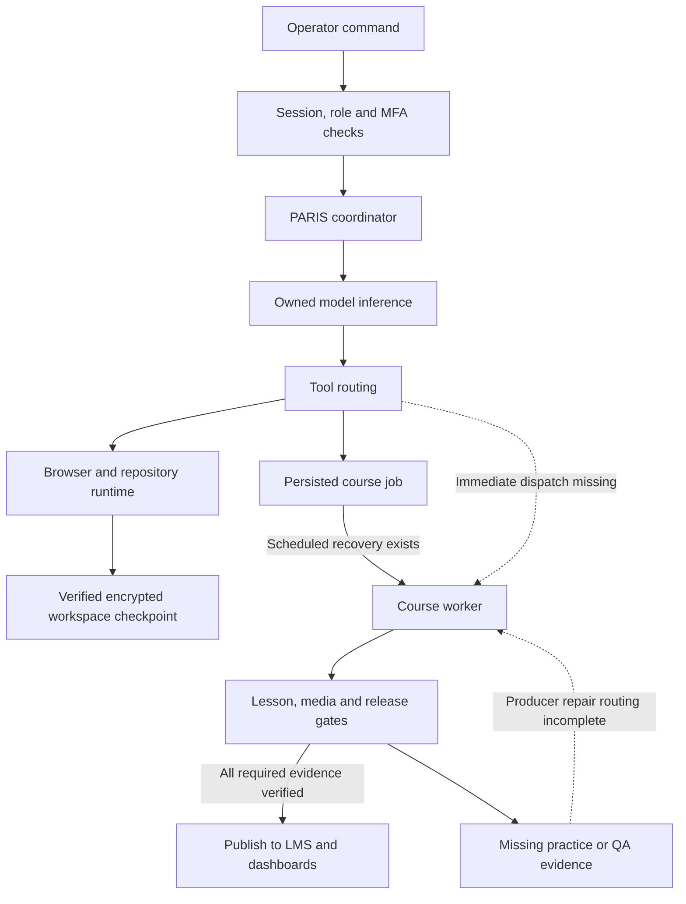

# PARIS runtime and platform audit checkpoint — 2026-10-24

**Status: not released and not production-ready.** This is an evidence checkpoint, not an acceptance certificate.

Recorded at 2026-10-24T06:15:38.104Z. Code reviewed through `0869cdf72b26a61f106b57e01dc6f543c6c89a75`.
GitHub was rechecked after the execution environment failed: `main` remains `1c6fae4c5ccc49c1366bfa38dfc91f14c8192e0a`.
Changes are on `fix/unified-paris-acceptance-20261023`; no PR was created and main was not promoted.

## What caused the reported failures

- Repository synchronization could race the initial file listing and durable checkpoint. A historical Git transfer temporary was approximately 988 MB, while the workspace checkpoint ceiling was 1 GiB. The accepted Git pack was approximately 143 MB. Filtered Git synchronization and exclusion of incomplete transfer temporaries preserve accepted Git data and user work.
- Unchanged reconnects still rewrote Git metadata and caused expensive full workspace snapshots. The new read-only fast path avoids those writes.
- The browser Supabase singleton acquired repeated setup/listeners. The pinned auth SDK also treats a raw refresh HTTP429 as permanent and removes the session. The candidate classifies refresh throttling as retryable and backs off without accepting expired credentials.
- Server and middleware refresh transports needed the same protection. API/request middleware now distinguishes temporary identity-provider failure from a permanently invalid session. Authorization and MFA checks remain required.
- Restored-terminal401/403 polling needed to stop until explicit reconnect, without discarding its recovery ID.
- Inferred Admin preview targets could still resolve to the production host from acceptance. The candidate keeps inferred Admin targets on the active deployment.
- The previously used Alpine Admin image lacked its configured Chromium executable and explicit dynamic composition dependencies. It is not a final production artifact. The canonical recipe now retains native media/browser packaging plus the newer portal, retry, stamping and service-worker navigation gates.
- Consolidating that recipe exposed active build consumers still selecting the old filename. Those references were aligned. A separate pre-existing separation check asserted obsolete helper text instead of the current registry/configuration behavior; it was updated to execute the real staging isolation tests.

## Verification evidence

| Target | Evidence | Observed result / limitation |
| --- | --- | --- |
| New runtime image | Cloud Build `fe32c8c0-0bb2-421b-bda4-d34721fc6818`, source262abf | SUCCESS; real Git/checkpoint suite10 passed. |
| Runtime acceptance revision | `elevate-studio-browser-00051-fec`, source262abf | Ready, isolated acceptance storage prefix, no production traffic. |
| Unchanged repository reconnect | Two protected calls against revision51 | HTTP200 in1.756s and1.299s; changed=false; manifest generation1792813167532632 unchanged. |
| Controlled process replacement | `/tmp/paris-runtime-replacement-262a.json` in Cloud Shell | Passed: file, tabs, active tab and viewport restored; process actually replaced; synthetic fixtures removed; no command replay or production traffic change. This does not claim restoration of OS processes. |
| Earlier replacement baseline | source6102 acceptance | Passed; initial full repository sync36.59s. A transient checkpoint failure was investigated; diagnostic logging now records bounded error categories without secrets. |
| Real auth SDK and SSR cookie behavior | Build11300138-ee34-4c9a-b4a3-ff42dec6819e, sourcece9434 | SUCCESS. Raw429 negative control removes session; guarded429 retains cookies and later rotates tokens; permanent400 remains rejected. |
| Actual middleware and server factories | Builda50f57ed-7c30-4187-8787-ba0f335e4c72, source5f3879 | SUCCESS, including actual factory cookie retention/recovery tests, repository initialization/polling tests and preview tests. |
| Complete source/auth build | Build7d97f093-5929-440a-8552-8433c668a732, source6e16db | All10 steps SUCCESS: preflight, Git/worker checks, full Next type/static build and full selected suites. Its Alpine packaging is unsuitable as the final native media runtime. |
| Earlier complete Admin build | Buildb363e9fa-7142-47db-baa5-7e5e80d603f4, source262abf | All10 steps SUCCESS, same packaging limitation. |
| Acceptance app | `elevate-admin-migration-00889-zaw`, source262abf | Ready at2026-10-24T05:16:01Z; linked to isolated runtime51. Authenticated browser acceptance remains pending sign-in. |
| Production traffic | Last Google read before environment loss | Admin00268-ms9 at100%; browser00045-wer at100%. No new production traffic activation. Current state cannot be reverified after environment loss. |
| Capacity recovery | Regional memory quota40GiB; old acceptance revision882 min1 | Removed only old zero-traffic test tag, retained revision, staged candidate with min0. New889 became ready. No quota increase or security-permission change. Restore intended production minimum explicitly during final activation. |
| Canonical native build |561f79df-d964-49e8-80a2-3561ed80fa6d, source573bacd | FAILED at source policy before image build: compatibility matrix still referenced unregistered old recipe. Source references subsequently repaired; native image has not passed. |
| Marketing/Store checks |73943e37-2501-4599-bd2f-a3f397ef50de, source573bacd | Same source-policy failure; typecheck/lint/image steps did not run. |
| LMS/worker checks |c802c5a5-1e48-4922-ad8b-650fd56a4798, source573bacd | Same source-policy failure; native worker/media policy not activated. |
| Employer/community regression |68f7a5ca-36f5-4e8c-94aa-51c8c8d8b130, sourcea69b5878 | Same source-policy failure; new5 employer and13 moderation tests are written but NOT executed. |
| Repaired source admission | source9edb9c | Memory/source policy PASS:3 apps,4 configs,10 image profiles,16 build workflows. Separation check then exposed obsolete loadGoogleConfig assertion. |
| Latest source gate | source0869cdf7 | Assertion replaced with actual stage-web tests. Last execution request lost transport; result is UNKNOWN, not pass. |

The successful unit/integration suites run with NODE_ENV=test. Full Next builds use production settings. Final packaged runtime and authenticated browser acceptance are separate gates.

## Actual source-change times

These are GitHub commit timestamps in UTC, not estimates of deployment completion.

| UTC | Commit | Change |
| --- | --- | --- |
| 2026-10-24T04:26:05Z | `262abf09a338` | fix(media): preserve checkpoint writer interface while refusing Supabase video writes |
| 2026-10-24T04:55:39Z | `63f9860d2586` | fix(auth): preserve SSR sessions on refresh throttling |
| 2026-10-24T05:07:37Z | `6e16db2b9b8d` | test(auth): verify real request middleware preserves outage semantics without granting access |
| 2026-10-24T05:25:23Z | `ca94ca44ab0e` | fix(admin): package the approved native runtime with repository and PWA acceptance checks |
| 2026-10-24T05:25:30Z | `573bacd95037` | fix(build): select the consolidated Google Admin production recipe |
| 2026-10-24T05:41:48Z | `ea34d136a2c7` | fix(admin): authorize employer creation at the server action boundary |
| 2026-10-24T05:48:30Z | `a47d9839fc63` | fix(community): verify moderation changed the requested record before reporting success |
| 2026-10-24T05:51:11Z | `a69b58781176` | test(community): keep the pre-fix regression control authenticated |
| 2026-10-24T06:03:41Z | `9edb9c473746` | fix(verification): check actual registry-selected Admin and LMS recipes |
| 2026-10-24T06:07:14Z | `0869cdf72b26` | test(deploy): verify staging ownership behavior instead of an obsolete helper call |

The complete implementation delta from main is62 commits across50 files, +1121/-219 lines.
[Full reviewed code delta](https://github.com/elevate-for-humanity/Elevate-lms/compare/1c6fae4c5ccc49c1366bfa38dfc91f14c8192e0a...0869cdf72b26a61f106b57e01dc6f543c6c89a75).

## External media migration

Existing private Backblaze B2 destination was tested with a real upload, readback/hash verification and cleanup of an isolated63-byte VTT fixture. Source Supabase objects have not been deleted and database video references have not been rewritten.

Verified copy counts include video, audio and caption objects; they are not counts of completed courses or videos.

| Execution | Range | Result |
| --- | --- | --- |
| media-transfer-20261024-rlpmz |0–24 |25 verified |
| media-transfer-20261024-bqfkz |25 onward |212 verified before transient streaming failure |
| media-transfer-20261024-864vj |237 |1 verified; isolated retry proved object readable |
| media-transfer-20261024-nwbjm |238–487 |250 verified, successful execution |
| media-transfer-20261024-hd9ks |488–737 |250 verified, successful execution |
| media-transfer-20261024-982r8 |738 onward, limit250 |Started; current outcome not verified after environment loss |

Total positively verified before the last execution: **738 objects**. Transfer recovery recreates upload/readback streams and retains strict size/SHA checks;4 focused retry tests passed locally and remotely. Final inventory reconciliation, URL cutover, private playback/range/caption verification and proof that every referenced video is external remain outstanding. The new video-write policy refuses Supabase video writes and fallback, but the final worker image still needs acceptance and activation.

## Course-builder findings and lesson evidence

- Cosmetology course a6b0b712-1cf0-475a-ba79-ee2023dea8ec; build572cca43-6bd6-4a91-b385-a8b576209c4e.
- Lesson1 approved351.318-second movie and255.638-second draft both reached ended without media error during the earlier runthrough. Release/build state was not complete.
- Lesson3, “Professional Ethics, Salon Conduct & Registered Apprenticeship Fundamentals,” version92, actually reached ended349s without media error. Its prior user-facing tab was preserved before tool loss. It remains built_with_findings and was not certified/published.
- Lesson3 genuinely lacks independent practice for the ethics objective and guided practice for the licensure objective. Existing tasks do not satisfy those missing modes; filling IDs would be false evidence.
- Blueprint authoring validates activity types globally, while release requires guided/independent practice per objective. The missing-coverage failure is discovered too late and lacks a structured repair route.
- Correct repair requires real source-grounded tasks, early coverage validation, current-checkpoint validation and explicit release findings routed to the actual blueprint producer. The current all-earlier-step hash model invalidates downstream render evidence. A new verified version may be needed; prior accepted videos must remain retained.
- Accessibility/learner QA has deferred/manual exceptions. Those are not evidence of completed live accessibility acceptance.
- Lesson2 has a teaching-photo replacement/approval blocker; no license approval was manufactured.
- Lesson4 is planned and unbuilt; it has not had the requested full runthrough.
- Chat build_course/generate_videos persists queue entries without immediate worker launch/error reporting. Scheduled recovery exists, so this is not proof that jobs never run.
- The standard worker launcher does not establish a fresh claim of the requested job. Exact owner-preview targeting must not be repurposed for full-course execution. Verify matching job/build/lease/generation/heartbeat and actual progress.
- Cosmetology, HVAC, Business, Retail, Barbering and Bookkeeping are **not all finished or newly published**.

## Wider dashboard audit

Implemented in the candidate, tests still pending:
- Employer creation now rechecks role at the actual server action, validates company name and propagates persistence failure.
- Community actions use the canonical role guard, require successful writes returning the requested row, and do not revalidate after failure. Failed reads show unavailable rather than a false empty moderation queue.

Source-proven remaining work, not silently marked fixed:
- QuickBooks Sync Expenses fetches/counts provider purchases but does not persist an expense import. An idempotent, protected, precision-preserving consumer and pagination are required.
- QuickBooks environment identity and database-global grants can be mixed across consumers. A shared identity-bound connection resolver/persister and callback/rotation/disconnect handling are needed. No QuickBooks records were imported, payments sent or authorizations revoked.
- Canonical nav lacks requested Community/Tax Office/demos/directory access. Existing Tax Office and demos belong on their correct host. URL validation plus normalization must change together; do not allow protocol-relative/unapproved targets or publish the unrestricted employer roster.
- A protected operational employer directory already exists at /employers. A separately filtered public view uses approval/listing flags; those boundaries must be preserved.
- Employer detail onboarding link needs built-route confirmation.
- Root page and Next redirect disagree on Studio versus Dashboard entry.
- Full phone, Store, tax/application flow, dashboard button, endpoint, mobile/PWA and all-program acceptance is incomplete. No live calls/messages or consequential financial actions were performed.

## Required working flow

Solid edges describe existing architectural boundaries; dashed edges identify required missing connections. This diagram does not certify that every boundary is operational.

## Resume order and release gate

1. Restore a usable execution/browser environment. The selected environment became unavailable; exec returned “No usable execution environment is available.” Browser controls were removed. This is a tooling outage, not evidence of a new application outage. Public web fetch could not reach the live telemetry URLs either.
2. Recheck current branch lease, Google traffic, last copy execution and source0869 gate outcome. Do not assume an unobserved command or external job succeeded.
3. Run source admission, the real staging ownership/isolation tests, separation and PWA navigation checks. Then run the47-case focused auth/repository/preview/employer/community group.
4. Build the consolidated canonical native Admin image with NF_GIT_SHA, real build timestamp and public Supabase arguments. Verify Chromium/native modules, real packaged composition bundling/render, unprivileged boot, identity and fresh offline narration.
5. Complete shared Marketing/Admin/LMS typechecks, lint and required image builds; latest post573 Admin changes require their own final image. Preserve exact source/digest evidence per artifact.
6. Finish course producer/repair/dispatch work, external media reconciliation and actual lesson4/program acceptance. Complete wider dashboard/phone/integration/navigation/mobile checks.
7. Complete authenticated acceptance after operator sign-in. Do not bypass authentication to make a test pass.
8. Before activation, reconcile the durable runtime configuration’s stale historical browser URL to the canonical Google binding. Compare the current secret version before writing. Preserve current production work/checkpoints; never activate the isolated acceptance storage prefix as production.
9. Recheck ignored/uncommitted runtime work, accepted manifest generation and both production/acceptance state. The last production Git audit was clean at97fc91835a9847445124332a61bb9f6ad138b1d4 with no local-only commits, but that does not prove ignored files were all checkpointed.
10. Only after all required evidence is green, promote directly to main without a PR, activate one coordinated release, restore intended production capacity, and verify live digests/SHAs, authenticated functions, storage and published course/dashboard behavior. None of those final steps is claimed complete here.

## Full current code-file inventory

This inventory excludes this checkpoint document itself.

| File | Status | Lines |
| --- | --- | --- |
| `.github/workflows/consolidation-docker-northflank.yml` | modified | +2 / -2 |
| `.github/workflows/deploy-admin.yml` | modified | +2 / -2 |
| `.github/workflows/video-queue-kick.yml` | modified | +0 / -1 |
| `Dockerfile.admin` | modified | +224 / -104 |
| `apps/admin/app/api/admin/dev-studio/chat/route.ts` | modified | +1 / -1 |
| `apps/admin/app/community/page.tsx` | modified | +29 / -15 |
| `apps/admin/app/employers/new/page.tsx` | modified | +6 / -2 |
| `apps/admin/middleware.ts` | modified | +14 / -0 |
| `components/studio/DevStudioHealthPanel.tsx` | modified | +2 / -0 |
| `components/studio/RealRepoWorkspace.tsx` | modified | +11 / -5 |
| `components/studio/RepositoryLivePreview.tsx` | modified | +3 / -3 |
| `lib/admin/guards.ts` | modified | +17 / -1 |
| `lib/storage/course-video-policy.mjs` | added | +8 / -0 |
| `lib/supabase/browser-auth-fetch.ts` | added | +70 / -0 |
| `lib/supabase/client.ts` | modified | +9 / -1 |
| `lib/supabase/middleware.ts` | modified | +2 / -1 |
| `lib/supabase/server.ts` | modified | +2 / -1 |
| `lib/ultimate-course-builder/core/lesson-contract.ts` | modified | +2 / -0 |
| `lib/video/checkpoint-fallback.mjs` | modified | +2 / -1 |
| `lib/video/remotion-render.ts` | modified | +3 / -5 |
| `lib/video/upload-lesson-media.ts` | modified | +18 / -3 |
| `scripts/audit-image-assets.mjs` | modified | +1 / -1 |
| `scripts/check-admin-lms-separation.sh` | modified | +6 / -4 |
| `scripts/check-integrations.mjs` | modified | +1 / -1 |
| `scripts/container-build-policy.mjs` | modified | +1 / -1 |
| `scripts/gcp/course-media-transfer-retry.mjs` | added | +30 / -0 |
| `scripts/gcp/course-media-transfer-retry.test.mjs` | added | +30 / -0 |
| `scripts/gcp/migrate-course-media-to-b2.mjs` | modified | +15 / -5 |
| `scripts/next-standalone-trace-excludes.mjs` | modified | +1 / -1 |
| `scripts/verify-build-identity.cjs` | modified | +1 / -1 |
| `scripts/verify-no-aws-deploy.mjs` | modified | +1 / -1 |
| `scripts/verify-repository-integrity.cjs` | modified | +1 / -1 |
| `services/studio-browser/repository-sync.mjs` | modified | +18 / -3 |
| `services/studio-browser/repository-sync.test.mjs` | modified | +7 / -0 |
| `services/studio-browser/server.mjs` | modified | +11 / -2 |
| `tests/unit/admin-auth-provider-unavailable.test.ts` | added | +18 / -0 |
| `tests/unit/admin-middleware-provider-unavailable.test.ts` | added | +22 / -0 |
| `tests/unit/community-moderation-failures.test.tsx` | added | +58 / -0 |
| `tests/unit/course-video-storage-contract.test.ts` | added | +28 / -0 |
| `tests/unit/employer-create-action.test.tsx` | added | +40 / -0 |
| `tests/unit/lib/upload-lesson-media.test.ts` | modified | +68 / -44 |
| `tests/unit/repository-preview-deployment.test.tsx` | added | +15 / -0 |
| `tests/unit/repository-workspace-initialization.test.tsx` | added | +68 / -0 |
| `tests/unit/studio-surface-contract.test.ts` | modified | +2 / -1 |
| `tests/unit/supabase-auth-refresh-backoff.test.ts` | added | +72 / -0 |
| `tests/unit/supabase-browser-client-initialization.test.ts` | added | +44 / -0 |
| `tests/unit/supabase-middleware-refresh-retention.test.ts` | added | +41 / -0 |
| `tests/unit/supabase-server-refresh-retention.test.ts` | added | +44 / -0 |
| `tests/unit/supabase-ssr-refresh-retention.test.ts` | added | +42 / -0 |
| `tests/worker/checkpoint-fallback.test.mjs` | modified | +8 / -5 |
