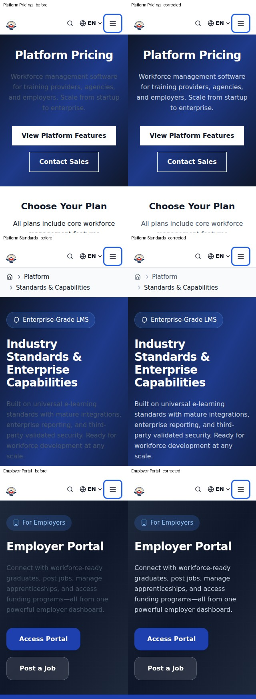
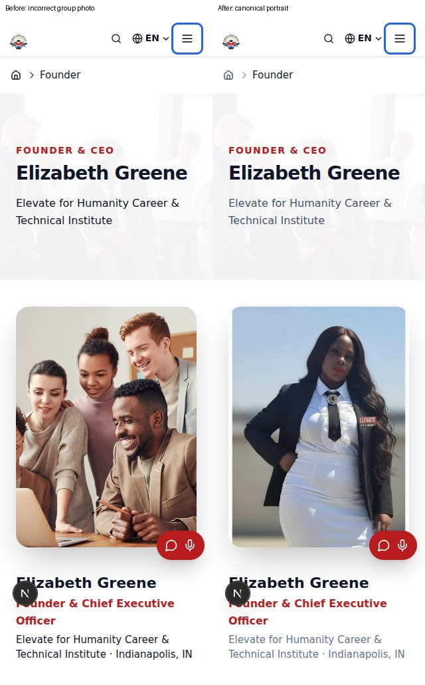

# Architectural design repair — acceptance record

**Deployment held.** This record does not certify all 195 findings as resolved. Authenticated and dynamic-state reviews remain open. The single existing PR is #1905; no merge or deployment was performed.

## Preserved work and architecture

The existing branch `repair/full-platform-design-architecture-20261016` includes main `8e9d4a67a049e53d7734e65ecaf4cacf0b509641`, preserving its Twilio credential, microphone readiness, public contact and voicemail-ingestion fixes. Valid earlier repairs were retained. Course Builder engines, workers and queues are unchanged.

- Marketing/Admin/LMS global patches no longer force component grids, colors, section backgrounds or typography. Shared contrast defaults now use a low-priority native cascade layer; a white page ancestor cannot recolor nested dark heroes or light controls. Accessibility focus, minimum target sizes and reduced-motion behavior remain.
- Studio chat-provided preview URLs reach the live frame; workspace height accommodates its controls/composer; preview/device controls have accessible labels and states. Existing services and AI operations remain connected through their original interfaces.
- Admin record lists scroll locally, with readable labels and shared card sizing. Authorization and database queries are unchanged.
- Public repairs cover mobile catalog titles/controls, breadcrumbs, statistics clipping, Connect form labels/contrast and explicit directory failure rendering. Header and drawer share the 1180px cutoff; open menus release scroll lock when resizing to desktop. Navigation is checked by real browser interaction, including Escape and focus restoration.
- Approved homepage photographs remain. Earlier media reconciliation uses eight distinct optimized illustrative assets and inspected existing program assets. The Founder portrait now uses the existing canonical organization profile asset, replacing an incorrectly assigned group-training photo; no new portrait was generated.

## Media policy

All 104 strict findings from the preceding PR head have individual dispositions in `image-policy-dispositions.json`. Eighty-four image instances now use an inlined 8×8 loading backdrop exported from the existing blur-placeholder module. Native video-poster and optional intrinsic-size logo exceptions have explicit rationales. Image Contract reports **0 critical / 0 strict**, with 227 existing reporting advisories.

An AST comparison verified original image source, alt, crop, dimensions, responsive sizing and loading priority during the backdrop repair. The later Founder source correction is a deliberate exception using `organization.founder.imagePath`; homepage image assignments are unchanged.

Canonical hero, homepage uniqueness, media integrity and the 1,598-route platform duplicate audit pass. Shared-component reuse and binary-alias advisories remain separate from blocking cross-program/route duplication. Legitimate gradients and backed player controls were retained.

## Finding traceability

The exact baseline `565cb8228d` reproduces the original 195 findings. Each original file/line, surrounding source, classification and disposition remains in the companion JSON/Markdown. The browser inventory rejects a missing or duplicate original record. Thirty-eight findings link to rendered public-route evidence.

The updated summary records 25 additional source/render-supported false positives, five corrected/render-verified findings, 19 source-verified findings and four source-verified/previously-corrected findings. Still open: 104 source-reviewed entries, 37 source-corrected entries awaiting rendered verification, and one partially verified image-overlay review. These are not all confirmed defects. See `finding-dispositions.json`; no blanket closure or suppression was applied.

`additional-confirmed-findings.json` records ten further defect groups found through rendering and interaction, including the shared contrast and tablet navigation failures.

## Verification

- Frozen install: **passed with pnpm 10.28.2**; dependency versions and lockfile unchanged.
- Marketing/Admin/LMS TypeScript and repository lint: passed. Final production-build and new-head workflow results are recorded in the PR verification section. The local Marketing production build passed; the scratch checkout was externally removed during Admin trace collection, interrupting the local build sequence. Clean GitHub container builds provide the remaining build evidence.
- Focused unit verification: 49 tests across eight files passed; seven audit regression tests passed.
- Browser coverage: 126 unique cases in bounded batches — seven representative routes across eight widths, plus 34 original-finding public routes at mobile/desktop and two shared-surface regressions. Required widths 320/375/390/768/1024/1440px and header boundaries 1179/1180px are covered. Targeted reruns verify the subsequent contrast, clipping and menu lifecycle corrections.
- Computed normal-text contrast assertions require at least 4.5:1 for the affected heroes, Community control, Pricing link and Connect input. Nested dark/light panels are tested through the actual compiled stylesheet.
- Image tests scroll through each visible lazy image and require a decoded asset; pending requests cannot count as passes. Carousel selection, target bounds, menu opening, Escape/focus and desktop resize cleanup are asserted.
- Hero/media/public-claims/application-route/enrollment/Studio architecture, credential, recovery-hardening and reliability guards were checked. No required workflow was disabled or weakened. Design Repair Verification now reruns the expanded public inventory in separate mobile/desktop steps and preserves distinct evidence directories.

See `browser-verification-summary.json` and `public-render-results.json`. The first large public run exposed an explicit directory failure and then lost its local dev server; smaller fresh-server batches passed. The authenticated orientation route is deferred by its actual enrollment requirement, rather than bypassed. Browser runtime packages are temporary and outside project dependencies. Only public Supabase client configuration was used locally.

## Visual evidence

The images below are actual local working-tree renders during repair, not production deployment certification.

## Remaining acceptance boundaries

A controlled authenticated Admin/LMS/Studio or enrolled-apprentice test session was not available in this runner. The repository's portal suite requires role-specific `E2E_*_EMAIL`/`E2E_*_PASSWORD` pairs; none of the Admin, learner, apprentice, Host Shop or Program Holder pairs were available. Private records, parameterized record states, all player/overlay states and actual application submission have not been certified. Local catalog timeouts also mean a geometry pass is not live database validation. All 147 possible custom-hero candidates remain an architectural review inventory, not 147 proven defects or an excuse to replace legitimate gradients.

The requested five checks passed on published head `8c5f47cbe2e19e314271c9ecf5a9f55313dc0f61`; their definitions, steps and decoded logs were inspected. The continuation must pass required checks on its new published head; the PR contains those final links. Do not infer production readiness solely from green regression gates.

No Northflank operation, Cloud Run deployment, Google Cloud build or course execution was initiated by this repair. PR automation was inspected: Marketing Staging Gate's misleading job name performs a GitHub-runner Docker build/smoke test, not a cloud deployment; deployment/recovery chains depend on main releases or explicit dispatch. Auto-merge remains off. Production revision/SHA verification belongs after an authorized merge and deployment.

## Main reconciliation and CI error preservation

Main advanced by two phone fixes during verification. GitHub’s merge checkout exposed three `preserve-caught-error` lint failures in the new microphone helper. The repair preserves the existing user-facing messages and capture cleanup while attaching the original error as `cause`. Its five existing microphone tests pass, with the three translated-error cases now asserting cause identity. The main updates were merged without conflicts.
